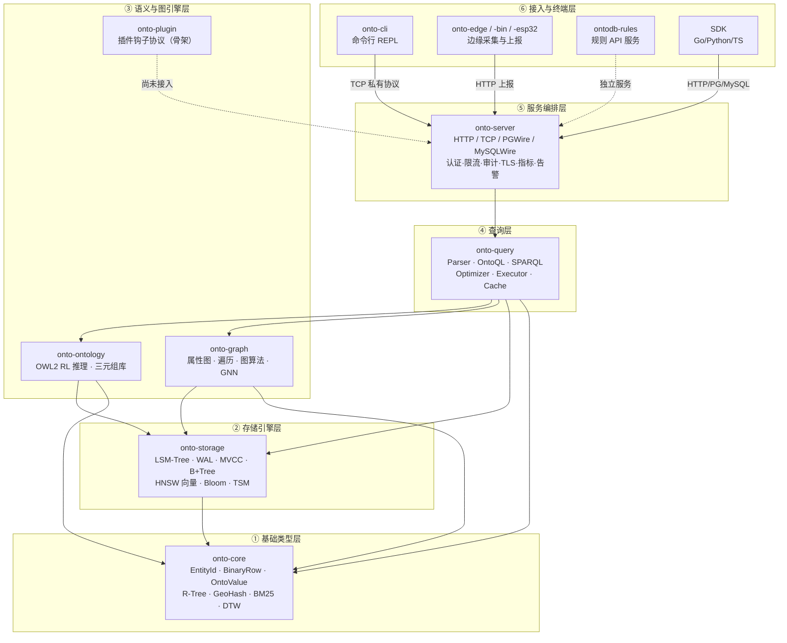
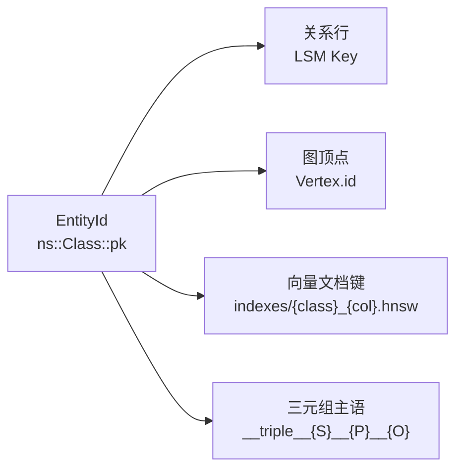
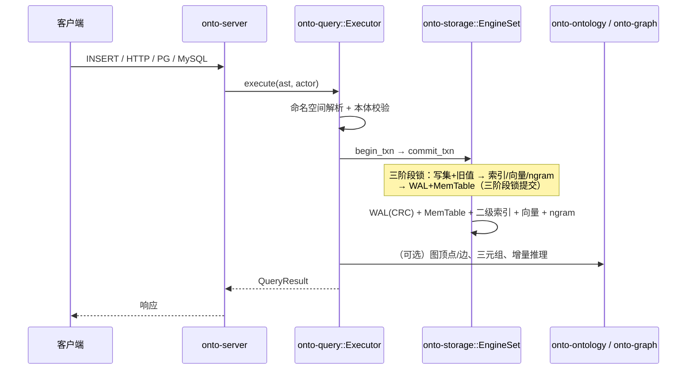
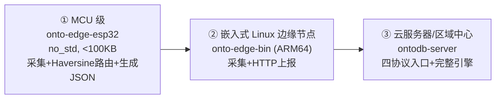

# OntoDB 整体架构

> 文档版本：基于 OntoDB v0.6.2 源码（workspace 版本见根 `Cargo.toml`）编写。
> 本文所有结论均来自对真实源码的阅读，关键处附「文件:行号」佐证。架构文档中区分**已实现能力**与**规划/边界**，详见每章末尾的「实现现状与边界」。

---

## 1. 系统定位

OntoDB 是一个**本体内核嵌入式的多模态语义数据库**。一句话概括其目标：

> 别的数据库存数据，OntoDB 让数据可理解、可推理、可校验。

核心设计主张（源自 `README.md:5-36`）：

| 主张 | 含义 |
|------|------|
| **一个引擎替代六个系统** | 关系 + 文档 + 全文 + 图 + 向量 + 时序 + 空间 + 三元组 + 流 + 事件等 12 种数据类型统一存储 |
| **本体即语义元数据** | 类继承 / 等价 / 互斥 / 传递等 OWL 2 RL 知识内嵌内核，可推理，而非应用代码里的硬编码 |
| **写入即语义就绪** | 数据写入时由内核增量推理、建索引、生成向量，省去跨系统 ETL |
| **统一查询语言 OntoQL** | 单一语法融合关系 + 图 + 向量 + 推理 + 时序 + 空间 |
| **边缘三级部署** | 从 ESP32 MCU 到云服务器统一数据模型与 API |

从源码看，OntoDB 是一个 **Rust workspace**（根 `Cargo.toml`），由 11 个核心 crate + 若干运维工具组成，约 12.4 万行 Rust 代码（不含 target）。

---

## 2. 分层架构

系统自下而上分为 6 层，依赖方向严格单向（下层不依赖上层）：



### 各层职责

| 层 | crate | 职责 | 依赖内部 crate |
|----|-------|------|----------------|
| ① 基础类型 | `onto-core` | 值与身份表示、二进制行格式、空间/时空/全文/时序算法数据结构 | 无（叶子底座） |
| ② 存储引擎 | `onto-storage` | LSM-Tree KV、WAL、MVCC、二级索引、HNSW 向量、TSM、备份恢复 | onto-core |
| ③ 语义与图 | `onto-ontology` | 本体模型/DDL/RDF、OWL 2 RL 推理、三元组存储 | onto-core, onto-storage |
| ③ 语义与图 | `onto-graph` | 属性图 CRUD、遍历、模式匹配、图推理、图算法、GNN、可视化 | onto-core, onto-storage |
| ③ 扩展骨架 | `onto-plugin` | 插件 Trait / Hook / 上下文 / 注册表协议 | 无 |
| ④ 查询 | `onto-query` | SQL/OntoQL/SPARQL 解析、代价优化、计划执行、缓存 | core/storage/ontology/graph |
| ⑤ 服务 | `onto-server` | 四协议接入、鉴权限流审计、TLS、指标告警、语义 API | query/graph/ontology/storage/core |
| ⑥ 终端 | `onto-cli` / `onto-edge*` / `ontodb-rules` | 命令行、边缘采集、独立规则服务 | 见各模块文档 |

> **依赖链一句话**：`core → storage → {ontology, graph} → query → server → 客户端`。`plugin` 与 `rules` 目前是尚未接入主链的独立/骨架组件。

---

## 3. 核心数据模型：统一语义锚点

OntoDB 各模态通过**统一实体身份**关联，目标是"零映射表"。

- 定义（`crates/onto-core/src/entity.rs:17-44`）：`EntityId { namespace, class, pk }`，三段式格式 `{namespace}::{class}::{pk}`，三个字段**强制必填**，杜绝多租户数据污染。
- 派生能力：同一 `EntityId` 生成 LSM key、图顶点 ID、向量文档键（`entity.rs:78-94`）。



**锚点格式的实现差异（重要，写文档时需如实说明）**：README（`README.md:210,354`）描述锚点为 `{Class}::{PrimaryKey}`、命名空间以类名点前缀承载（如 `Bioet.Drug::{pk}`）；而 `EntityId` 类型实现的是三段式 `{namespace}::{class}::{pk}`（`entity.rs:78-94`）。`onto-graph` 的顶点 ID 复用了 `EntityId` 格式（`store.rs:1525-1536`）。即：**概念层统一，但不同模块的键前缀方案存在两种形态**，这是阅读源码时容易困惑之处。

---

## 4. 12 种数据类型的模块落点

README（`README.md:191-210`）声明 12 种数据类型。源码中的落点如下（注意并非每种都有独立的端到端执行路径）：

| 数据类型 | 主要承载模块 | 实现程度 |
|----------|--------------|----------|
| 键值对 | onto-storage（LSM KV） | 完整 |
| 文档（JSON/BSON） | onto-storage + onto-core::BinaryRow | 完整 |
| 文本（倒排索引/BM25） | onto-core::fulltext | 索引结构完整，执行器接线有限 |
| 多媒体 | onto-core::multimedia（SHA256/元数据） | 注册与哈希完整 |
| 结构化记录 | onto-storage + onto-query（SELECT/DML） | 完整 |
| 图结构 | onto-graph | 完整（CRUD/遍历/算法） |
| 向量索引 | onto-storage::vector（HNSW） | 完整（含增量/聚类/混合） |
| 时序数据 | onto-storage::tsm + onto-core::time_series | TSM 原型，未接入主引擎 |
| 空间数据 | onto-core::geo / geohash_index / rtree | 数据结构完整 |
| 语义三元组 | onto-ontology::triple_store | 完整（SPO/POS/OSP 三索引） |
| 流数据 | onto-server::cdc + onto-graph::streaming | **框架代码，未接线** |
| 事件数据 | onto-graph::streaming_compute | 原型，未接线 |

---

## 5. 关键数据流

### 5.1 写入链路（产品宣称的"七步写入联动"）

README 宣称一次 INSERT 原子完成「文档→图→三元组→推理→向量→索引」（`README.md:7,221`）。从源码看，这是**跨 crate 的产品级编排能力**，落地在各层原语：



**结论**：存储层 `commit_txn` 确实在一次事务内同步维护 KV + 二级索引 + 向量 + n-gram（`engine.rs:4179-4375`）；图/三元组/推理的联动依赖上层显式调用，并非单一函数内的原子七步。写文档时应表述为"产品级联动 + 存储底座支撑"。

### 5.2 查询执行链路

详见 `05-onto-query-查询引擎.md`。主干为：

```
查询文本(SQL/OntoQL/SPARQL)
  → Parser → 统一 QueryAst
  → QueryPlanner（谓词下推 + 多候选 + CostModel 择优）→ ExecutionPlan
  → QueryExecutor（短写锁路径 / 只读并发快路径 / 计划解释器）
  → LsmEngine 扫描 / OntologyStore 推理 / GraphStore 遍历 / HNSW 检索
  → QueryResult → 协议层格式化
```

关键设计：OntoQL 与 SPARQL 都采用"**生成 SQL 字符串 → QueryParser 重解析**"接入统一执行器（`ontoql.rs:2144-2151`、`sparql.rs:1176`），避免多套执行器。

### 5.3 推理链路

详见 `04-onto-ontology-本体推理.md`。`Reasoner` 采用 semi-naive 增量求值 + 三类快路径：

1. 传递闭包 BFS（快路径 1）
2. 按类批量类型传播（快路径 2）
3. 迭代不动点循环（其余规则）
4. 一致性检查 + 可解释追溯 + 四种推理模式（全量/并行/流式/增量）

---

## 6. 技术栈

| 领域 | 选型 |
|------|------|
| 语言 / 构建 | Rust 2021 edition，Cargo workspace，resolver 2 |
| 异步运行时 | tokio（server）；parking_lot / crossbeam 用于同步 |
| 序列化 | serde / serde_json / simd-json / bincode |
| 压缩 | zstd（含 vendored 补丁 `vendor/zstd-sys`，修复 zstd 1.5.7 两个 bug） |
| 网络 | axum（HTTP）、rustls/aws-lc-rs（TLS）、自实现 PGWire v3 / MySQL v4.1 |
| 错误处理 | thiserror / anyhow，统一 `CoreError` |
| 观测 | tracing / tracing-subscriber，Prometheus 格式指标 |
| 图并行 | rayon（BFS 并行） |
| 分布式 | 私有 crate `onto-raft` / `onto-sharding` / `onto-enterprise`（开源仓库不可见，feature gate 占位） |

---

## 7. 部署架构

### 7.1 边缘三级部署（`README.md:24,340`）



- **第一级**：`onto-edge-esp32` 是 workspace 外的 `no_std` 库，只生成上报 JSON 字符串，由固件发送。
- **第二级**：`onto-edge-bin`（`Dockerfile.edge-arm64`，`scratch` 镜像）采集并 POST 上报至区域节点。
- **第三级**：`ontodb-server` 提供 HTTP(7912) / PG(7913) / MySQL(7914) 端口，容器化 + K8s/Helm + Prometheus/Grafana 监控。

> 边界：`onto-edge` 上报的 `/api/edge/report` 端点在当前 server 路由中**不存在**，上报链路的接收端尚未在开源代码实现。

### 7.2 进程模型

`onto-server::main` 在单进程内以 `futures::select_all` 并发运行 HTTP、TCP、PGWire、MySQL、（可选）Raft 五类服务 + 优雅退出哨兵（`main.rs:751-802`）。设计哲学：**任一服务失败则整体退出**，交给 systemd/Docker 重启，不在降级态运行。

---

## 8. 命名空间与多租户隔离

- 隔离在**存储键层**以类名点前缀承载（`README.md:354`）：`USE NAMESPACE Bioet` 下裸类名 `Drug` 落盘为 `Bioet.Drug::{pk}`。
- `EngineSet` 为每个 namespace 维护独立 `LsmEngine`，按 key/class 前缀路由（`engine_set.rs:95,274,329`），**拒绝跨命名空间事务**（`engine_set.rs:726`）。
- 查询层 `QueryActor { label, namespace, client_ip }` 注入作用域（`executor.rs:521`），裸类名自动加盖 session 命名空间前缀（`executor.rs:2652-2662`）。
- 图引擎按顶点 ID 首段命名空间路由到不同引擎（`store.rs:495-502`）。
- 隔离语义：防意外不防显式——裸名互不可见，限定名 `ns.Class` 可显式跨空间读取。

---

## 9. 架构成熟度说明（诚实标注）

作为架构文档，必须区分"设计宣称"与"当前实现"。源码中已确认的**主要边界**：

| 能力 | 状态 | 证据 |
|------|------|------|
| 联邦查询 / 语义缓存 / 融合优化器 | 已实现为独立组件，**未接入主执行路径** | 全仓除自身文件外引用为 0 |
| CDC 变更捕获 | 框架完整，**未接线**（CLI 参数未读取，无 CdcManager 调用） | `main.rs:34,228-237` |
| 分层存储 (TieredStorage) / TSM | 原型，**未被 LsmEngine 使用、未从 lib.rs 导出** | `tiered_storage.rs:141-144` |
| onto-plugin 插件系统 | 协议骨架，**无任何 crate 依赖，无调用点** | 全仓 grep |
| onto-graph 分布式 / GNN / 流式计算 | 进程内模拟 / 前向推理演示 / 未接线，**服务端有静态 stub** | `distributed.rs`、`http.rs:4092-4166` |
| 边缘上报接收端 | 客户端有上报，**服务端无对应路由** | `reporter.rs:70` vs server 路由表 |
| enterprise feature | 私有 crate 不可见，社区版部分端点返回 403 stub | `Cargo.toml:23-25`、`http.rs:943-962` |
| 向量增量持久化 | 已废弃，改为"文档为真值源 + 全量快照" | `engine.rs:556-566` |

这些都将在对应模块文档中详细展开。结论：**核心引擎（存储、本体推理、查询执行、图 CRUD/遍历、多协议服务）是扎实可用的；而 README 中部分"33 项核心技术"属于规划或原型能力**。

---

## 10. 文档导航

| 文档 | 内容 |
|------|------|
| [00-整体架构.md](00-整体架构.md) | 本文：系统定位、分层、数据模型、关键数据流、部署 |
| [01-onto-core-核心类型.md](01-onto-core-核心类型.md) | 核心类型：EntityId、BinaryRow、空间/全文/时序算法 |
| [02-onto-storage-存储引擎.md](02-onto-storage-存储引擎.md) | LSM-Tree、WAL、MVCC、索引、HNSW、TSM |
| [03-onto-ontology-本体推理.md](03-onto-ontology-本体推理.md) | 本体模型、OWL 2 RL 推理、三元组库、RDF |
| [04-onto-query-查询引擎.md](04-onto-query-查询引擎.md) | Parser、优化器、执行器、OntoQL/SPARQL、缓存 |
| [05-onto-graph-图引擎.md](05-onto-graph-图引擎.md) | 属性图、遍历、图算法、GNN、分布式、可视化 |
| [06-onto-plugin-插件系统.md](06-onto-plugin-插件系统.md) | 插件 Trait、Hook、注册表、生命周期 |
| [07-onto-server-服务层.md](07-onto-server-服务层.md) | 四协议、认证、限流、审计、TLS、指标、语义 API |
| [08-onto-cli-命令行.md](08-onto-cli-命令行.md) | 命令行客户端、REPL、dump/restore |
| [09-onto-edge-边缘计算.md](09-onto-edge-边缘计算.md) | 边缘 SDK、上报、ESP32、三级部署 |
| [10-ontodb-rules-规则服务.md](10-ontodb-rules-规则服务.md) | 独立规则 API 服务、DSL |
| [11-已知边界与技术债.md](11-已知边界与技术债.md) | 全仓"声明 vs 实现"差异汇总 |
