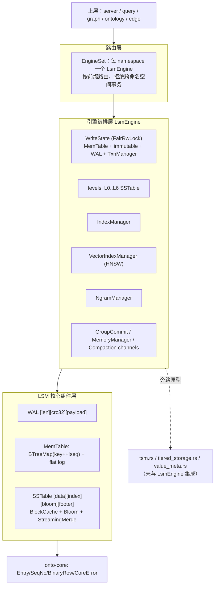

# onto-storage —— 存储引擎模块

> 定位（Cargo.toml:6）："LSM-Tree storage engine for OntoDB"。
> 源码规模：约 3.3 万行，是项目最核心、最复杂的模块。唯一内部依赖为 `onto-core`。

---

## 1. 职责与边界

onto-storage 负责**单节点上的持久化 KV 引擎 + 各类索引**：

- LSM-Tree：WAL → MemTable → SSTable → 后台 Compaction
- MVCC 快照隔离事务
- 二级索引：内存/磁盘/混合三态 B+Tree + CJK n-gram
- 向量相似度索引：HNSW + 多距离度量 + 聚类 + 混合检索
- 多命名空间引擎路由、备份恢复、活数据价值衰减、哨兵校验

**边界外**：本体/图/三元组/推理语义（上层 crate）、网络/SQL 解析。README 宣称的"七步写入联动"是产品级跨 crate 能力，本模块只提供其**存储侧原语**。

---

## 2. 整体架构

---

## 3. 对外核心类型（`lib.rs:45-59`）

| 类型 | 位置 | 作用 |
|------|------|------|
| `LsmEngine` | `engine.rs:113` | 核心引擎，方法均为 `&self`，可 `Arc` 共享 |
| `EngineSet` | `engine_set.rs:95` | 多命名空间路由器 + 路由级事务 |
| `StorageOptions` | `options.rs:11` | 配置（默认 64MB MemTable、4KB block、7 层、size_ratio=3、zstd level 2） |
| `StorageIterator`（trait） | `iterator.rs:9` | 统一 KV 迭代接口 |
| `Transaction` / `TxnManager` / `TxnStatus` / `WriteOp` | `mvcc/` | MVCC 事务与写缓冲（`WriteOp::{Put,Delete}`） |
| `IndexManager` / `IndexStorageMode` | `index/manager.rs:428` | 二级索引管理；三态 `{InMemory,DiskBased,Hybrid}` |
| `HnswIndex` / `VectorIndexManager` / `VecData` / `DistanceMetric` | `vector/` | 向量检索；`VecData::{Dense,Packed}` |
| `ValueMetadata` / `ValueScorer` | `value_meta.rs` | 活数据价值评分与指数衰减（半衰期 7h/70d/2y） |
| `check_node_ptr` / `checked_vec` 等 | `ptr_guard.rs` | 堆指针/Vec 哨兵校验 |

> 澄清：仓库中**不存在 `WriteBatch` 类型**。批量写接口是 `LsmEngine::put_batch`（`engine.rs:1016`）、`txn_put_batch`（`:4447`）与 `WriteOp`（`mvcc/transaction.rs:22`）。

---

## 4. 核心机制

### 4.1 WAL 写入与恢复

- 格式：`[length:u32][crc32:u32][payload]`，payload = seq_no + kind + key + value（`wal.rs:6,209-226`）。
- 零克隆快路径 `append_raw_put()`（`:179-206`）；批量 `append_batch` 单次 flush（`:85-100`）；后台每 100ms 兜底 fsync（`engine.rs:465-491`）。
- **恢复**：顺序解析，遇第一个 CRC 不匹配/畸形条目即停止（`wal.rs:273-347`），防止损坏的 length 字段级联误读。
- **Group commit**：leader 等待 10µs 或 4 个事务即触发单次 fsync（`group_commit.rs:17-30,85-154`）。

### 4.2 MemTable

- `BTreeMap` + 复合键 `user_key ++ !seq_no`（大端）实现"同 key 最新版本排最前"（`memtable.rs:9,24-32`）。
- 并行维护 `flat: Vec<MemTableEntry>` 插入序日志供 flush 使用，**刻意不遍历 BTreeMap**（注释记载 std 内联迭代器曾导致 AV，`:50-55,271-289`）。
- 墓碑 `VersionLookup::Tombstone` 是终态，禁止回落到更旧层防删除复活（`:247-261`）。

### 4.3 SSTable

- 物理格式：`[data blocks][index block][bloom filter][footer]`（`sstable.rs:6-14`）。
- Footer：新格式 33 字节（含 max_seq_no），magic `0x4F4E544F_44425353`（"ONTO_DBSS"，`:28-36,739-768`）。
- 块格式：`[flags:1][payload][crc32:4]`，CRC 覆盖 flags+payload（`:39,553-558`）。
- 原子写：`.sst.tmp` → fsync → rename（`:592-659`）。
- 读取优化：`OnceLock` 延迟加载 index/bloom（避免 1300+ SST 启动时物化数 GB 内存，`:800-810`）；二分找块；顺序扫描预取后 2 块（`:1213-1238`）。

### 4.4 Compaction

- 独立 OS 线程（32MB 栈），100ms tick，通过 mpsc 与引擎双向通信（`compaction_worker.rs:108-161`）。
- 评分调度 `max(size_score, file_score)`，L0 目标 8 文件、最深 64；带饥饿提升（idle/120s，最多 4×，`:419-428`）。
- 四类合并：跨层、同层自合并、最深层有界重写、小文件合并（`:693,1182,1449,1683`）。
- **Streaming merge**：`BinaryHeap` k-way 归并，反转 key 比较实现"key 升序、同 key seq 降序"，不把全量条目载入内存（`streaming_merge.rs:87-182`）。
- **墓碑安全**：`tombstone_span` 扩张合并集合，`tombstone_safe_to_drop` 仅在无 survivor 覆盖时丢弃墓碑（`:833-942,1915-1927`）。
- **写回压**：发布 `compaction_debt`，写路径在落后时主动休眠（`engine.rs:965-973`）。

### 4.5 MVCC 事务

- `TxnManager::begin(current_seq)` 把快照设为引擎当前 seq（`mvcc/manager.rs:19-56`）。
- 可见性：`is_visible(ts) = ts <= snapshot_ts && !active_txns.contains(ts)`（`mvcc/visibility.rs:43-45`）。
- `next_seq` 用 `AcqRel` fetch_add 保证快照隔离，**明确拒绝 thread-local 批量分配序号**（`engine.rs:3150-3156`）。
- **三阶段锁提交**（`commit_txn`，`engine.rs:4179-4375`）：① 取写集并读旧值 → ② 无写锁下改索引/向量/ngram → ③ 短暂写锁写 WAL+MemTable。
- 局限：每个 executor 仅一个活跃事务（`executor.rs:484-487`）；`is_latest_visible` 未被 compaction 使用。

### 4.6 索引子系统

- 索引作为 LSM KV 存储：`__idx2__ || class || col || value || pk`，value 为空（`index/mod.rs:6-8`）。
- **保序类型编码**（设计亮点）：Null(0x01)<Bool<Int<Float<String，整数翻转符号位、Float 按符号分支翻转，payload 转义 `0x00→0x00 0xFF`，保证字节序==逻辑序（`index/manager.rs:1785-1854`）。
- 三态存储 + 磁盘 B+Tree（4KB 页、slot array、叶兄弟链、BufferPool LRU，`index/disk.rs`）+ 混合游标归并（`index/manager.rs:153-423`）。
- n-gram：2-gram 倒排，从最小 posting list 起求交；needle<2 返回 None 让上层回退全扫（`index/ngram.rs:18,60-99`）。

### 4.7 向量 HNSW

- 紧凑表示 `VecData::{Dense(Vec<f32>), Packed(Vec<u8>)}`：全 0/1 向量位打包（1024 位仅 128 字节）（`hnsw.rs:20-73`）。
- 距离度量：L2/Cosine/IP/Hamming/Tanimoto；Packed 对用 popcount 实现（Tanimoto 即 1-Jaccard，化学指纹标准度量，`distance.rs:6-76`）。
- HNSW 算法：随机层级、两阶段插入、自顶向下贪心 + 第 0 层 beam；`ef_search` 可运行时调节；`search_filtered` 扩大 ef 后按 allowed_ids 过滤（`hnsw.rs:583-926`）。
- 辅助：K-Means++/mini-batch 聚类、RRF 多向量混合、Cosine 预归一化（约 2×）、冷启动预热。

### 4.8 TSM / 分层存储 / 哨兵校验

- TSM 列存：时间戳 delta、浮点 XOR、zstd 块压缩（`tsm.rs`）——**简化版，未接入主引擎**。
- TieredStorage：hot/warm/cold 三层定义——**未导出、未集成**。
- **哨兵校验（ptr_guard.rs）**：拒绝非规范堆指针、识别损坏 Vec 头（cap==0&&len>0、len>cap 等），遇损坏**带快照 panic 而非静默降级**（`:15-93`）。植入 MemTable flush、SST 编码、streaming merge；仓库根 `bug.md` 记录了历史堆损坏根因与修复。

---

## 5. 依赖关系

- **依赖**：仅 `onto-core`（Entry/SeqNo/BinaryRow/CoreError、binary_fp）。
- **被依赖**：`onto-edge`、`onto-graph`、`onto-query`、`onto-server`、`onto-ontology`——**数据平面的底座**。

---

## 6. 设计亮点

1. **块级 CRC + 全链路完整性**：SST 每块 CRC、索引块 CRC、WAL 每条目 CRC、备份清单 CRC32。
2. **哨兵校验 / 堆损坏 fail-fast**：静默空值会在 compaction 中错序/毒化 SST，比崩溃更糟——选择带快照 panic。
3. **删除绝不复活的系统性设计**：MemTable 墓碑终态、读顺序论证、compaction 墓碑安全扩张与排除。
4. **原子文件替换三连**：SST `.tmp→.sst`、WAL 重建再 rename、HNSW 快照 `.hnsw.tmp→.hnsw`。
5. **group commit 混合批处理** + **写回压与饥饿治理**。
6. **索引类型化保序编码 + 混合游标归并**。
7. **向量紧凑化与化学指纹友好度量**（Packed + Tanimoto）。
8. **启动性能工程**：`open()` 刻意不重建索引/向量（"keeps startup fast ~1s"，`engine.rs:500-502`），交给后台。

---

## 7. 实现现状与边界

1. `WriteBatch` 名称不存在（见 §3 澄清）。
2. MemTable 底层是 `BTreeMap` 而 `lib.rs:27` 注释仍称 "skip list"。
3. **向量增量持久化已废弃**但模块仍在：`incremental_persist.rs` 的 delta 设计与 `engine.rs:556-566` 矛盾；现策略为脏节点>20000 写全量快照，其余靠文档回填恢复。
4. TieredStorage / ContinuousQueryEngine 未集成、未导出；warm 查询未实现，cold 仅文件搬移。
5. MemoryManager 构造但未接入主写入路径（方法无调用点）。
6. TSM 编码为简化版（定长 delta、非位级 Gorilla）。
7. `Visibility::is_latest_visible` 未完成（仅转发 is_visible）。
8. v1/v2 索引双格式（`__idx__` / `__idx2__`）并存，维护负担。
9. 跨命名空间事务不支持；未注册命名空间的数据落默认引擎待迁移。
10. `engine.rs.bak` 遗留文件；`bug.md` 记录堆损坏残留疑点。
11. 恢复后索引/向量重建异步化，依赖调用方触发。
12. `GroupCommitCoordinator::register(_seq)` 忽略 seq 参数，极高并发下语义偏保守。
