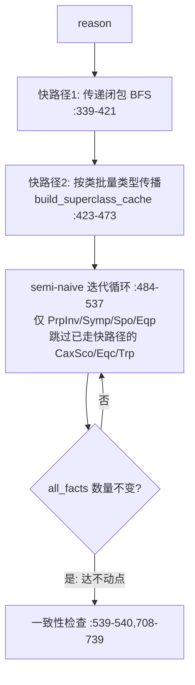

# onto-ontology —— 本体推理模块

> 定位（Cargo.toml:6）："Ontology engine - model, parser, store, and inference for OntoDB"。
> 源码规模：约 5,344 行，7 个模块。依赖 `onto-core` + `onto-storage`，处于中间层。

---

## 1. 职责与边界

onto-ontology 负责**本体知识如何建模、导入导出、推理、落盘**：

- 本体数据模型（TBox/ABox）、DDL 解析、RDF 互操作
- OWL 2 RL 推理机（可插拔规则 + 不动点算法）
- 本体/三元组在 LSM 上的持久化

**边界外**：SQL 解析（onto-query）、RPC/HTTP（onto-server）。它是被查询层与服务层复用的中间件。

---

## 2. 模块划分

| 模块 | 职责 |
|------|------|
| `model.rs` | 本体数据模型 + 层级/等价/不相交/校验算法 |
| `parser.rs` | `CREATE ONTOLOGY` DDL → Ontology |
| `rdf.rs` | Turtle 子集导入 + N-Triples/JSON-LD 导出 |
| `rules.rs` | OWL-lite 规则 trait 与 7 条具体规则（增量友好） |
| `reasoner.rs` | 不动点推理机（快路径/流式/并行/增量/解释） |
| `store.rs` | Ontology/Namespace 在 LSM 上的持久化、命名空间合并 |
| `triple_store.rs` | SPO/POS/OSP 三索引三元组库，按命名空间路由 |

---

## 3. 对外核心类型（`lib.rs:35-46`）

| 类型 | 位置 | 作用 |
|------|------|------|
| `Ontology` | `model.rs:37-50` | 命名本体：classes/properties 两张 HashMap + 反向索引 `children_of`/`equiv_of`（`#[serde(skip)]`） |
| `Namespace` | `model.rs:16-33` | 多项目隔离命名空间 |
| `Class` | `model.rs:128-152` | 类：超类、属性、等价/不相交类、Restriction、唯一约束 |
| `Property` | `model.rs:156-193` | 属性：domain/range/`range_class`、required/multi_valued、OWL 特性（等价/逆/传递/对称/函数/子属性） |
| `DataType` / `ClassType` / `Restriction` / `Literal` | `model.rs:54-232` | OWL-lite 表达能力：枚举/并/交类、六种限制、字面量 |
| `Triple` | `model.rs:893-918` | SPO 三元组，`Hash+Eq`，推理机工作单元 |
| `OntologyParser` | `parser.rs:20-298` | 解析 `CREATE ONTOLOGY` DDL |
| `TurtleParser` / `to_ntriples` / `to_jsonld` | `rdf.rs` | RDF 导入导出 |
| `Reasoner` / `InferredFact` / `ReasoningStats` / `DerivationStep` | `reasoner.rs:14-782` | 推理机及结果/诊断/解释类型 |
| `Rule`（trait） / `RuleId` / `default_rules` | `rules.rs:20-50,472-482` | 可扩展推理规则接口与 7 条默认规则 |
| `OntologyStore` | `store.rs:14-246` | 本体持久化（默认命名空间 `_default`） |
| `TripleStore` | `triple_store.rs:28-52` | SPO/POS/OSP 三索引三元组持久化 |

---

## 4. 核心机制

### 4.1 类层级与校验

- `add_class` 维护 `children_of`（父→子）与 `equiv_of`（等价双向）反向索引（`:253-269`）；`rebuild_indexes()` 在 JSON 反序列化后自动重建（`:272-296`）。
- `get_all_subclasses` 三路扩展（子 + 双向等价 + equiv_of，`:397-440`）——这是"查父类自动含子类"的底层。
- `resolve_property` 三级回退解决多本体合并后同名属性遮蔽（`:329-338`）。
- `validate()` 六项检查（`:557-579`）：**继承环检测用白/灰/黑三色 DFS 并输出环路径**（`:586-640`）、等价环检测、不相交约束求交、未定义引用检查。

### 4.2 七条 OWL 2 RL 推理规则（`rules.rs:4-13`）

统一 `Rule` trait（`Send + Sync`，可插拔）；核心约定：`apply(ontology, facts, new_facts)` 中 `new_facts` 为空表示首轮全量扫描，非空表示只从新增事实做**增量扩展**。

| 规则 | 语义 | 实现要点 |
|------|------|----------|
| `CaxSco` | x∈A ∧ A⊑B ⇒ x∈B | 用 `get_all_superclasses`（`:57-92`） |
| `CaxEqc` | x∈A ∧ A≡B ⇒ x∈B | `:99-134` |
| `PrpSpo` | 子属性继承 | 递归收集超属性，visited 防环（`:141-197`） |
| `PrpEqp` | 等价属性互替 | `:204-239` |
| `PrpInv` | 逆属性 | 预计算反向索引避免全扫，双向处理（`:246-303`） |
| `PrpTrp` | 传递性 | 首轮建 obj_map；增量轮前后向扩展 + 索引（`:312-427`） |
| `PrpSymp` | 对称性 | `:434-469` |

### 4.3 不动点推理主流程（`reasoner.rs:330-549`）

- 资源护栏：`max_iterations=100`、`max_facts=1,000,000`（`:86-92`）。
- **四种推理模式**：全量 `reason`、并行 `reason_parallel`（`std::thread::scope` 每规则一线程，`:322-327`）、流式 `reason_streaming`（sink 回调即时发射、返回 false 提前终止、内存有界，`:132-320`）、增量 `reason_incremental`（有 removed 则退化为全量重算，`:577-705`）。
- **可解释性**：`InferredFact{rule, premises}`，`explain` / `find_premises` 反向搜索前提（`:741-946`）——支撑语义 API 的 `/explain` 端点。

### 4.4 本体持久化与三元组库

- `store.rs` key 方案：`__ontology__{namespace}::{name}`、`__ns__{name}`（`:14-18,216-245`）；默认 `_default` 隐式存在（`:91-109`）；`merge_namespace_ontologies()` 合并同名本体（`:178-214`）。
- **三索引三元组库**（`triple_store.rs`）：
  - SPO `__triple__{S}__{P}__{O}`、POS `__triple_pos__{P}__{O}__{S}`、OSP `__triple_osp__{O}__{S}__{P}`（`:4-16,302-330`）
  - 写入一次三键齐写、幂等（`:70-89`）；按 subject 类路由到对应命名空间引擎（`:60-68`）
  - 键转义 `\\→\\\\`、`_→\\_` + 自定义 split 抗碰撞（`:332-422`）

### 4.5 DDL 与 RDF

- `OntologyParser` 解析 `CREATE ONTOLOGY`：`split_statements()` 用括号深度避免拆分嵌套（`:103-126`）；`parse_class` 支持 `SUBCLASS OF`/`EXTENDS`；`parse_property` 识别 REQUIRED/MULTI_VALUED（`:230-297`）。
- `TurtleParser` 是轻量子集解析器（`@prefix`、IRI 展开），把三元组归类为 class/subClass/equivalent/disjoint/inverse/transitive 等并组装本体（`:79-260`）。

---

## 5. 依赖关系

- **依赖**：onto-core（仅 CoreError/Result）、onto-storage（LsmEngine/EngineSet）。
- **被依赖**：onto-query（最重用户，executor.rs 大量使用）、onto-server（基础推理为标配）。

---

## 6. 设计亮点

1. **规则即 trait 对象、可插拔**：`Reasoner::with_rules()` 可替换规则集。
2. **semi-naive 增量求值 + 三类快路径**：性能核心工程手段（README 称增量推理 50.8µs）。
3. **四种推理模式覆盖不同场景**（全量/并行/流式/增量）。
4. **推理可解释 + 可诊断**：规则来源、前提、统计字段齐全。
5. **资源护栏**防传递闭包内存爆炸。
6. **索引化与路由化的持久化**：三索引 + 命名空间路由 + 批量分组写 + 抗碰撞转义。
7. **语义与存储类型分离**：`Property.range`（存储类型）与 `range_class`（对象属性语义目标）双字段。

---

## 7. 实现现状与边界

- `reason_inner` 并行分支对所有规则并发 apply（`:488-501`），顺序分支跳过快路径规则（`:507-516`）——**两条路径规则集不同**。
- `ReasoningStats.iterations` 在流式路径中恒为 0（`:139,314`）。
- `validate_no_equivalent_cycles` 只沿 `equivalent_classes.first()` 单链追踪（`:659-663`），可能漏检多分支等价图中的环。
- 服务端存在**两套推理器**：本模块 `onto_ontology::Reasoner`（本体推理，query executor 使用）与 `onto_graph::Reasoner`（图三元组规则，图 API 使用），不要混淆。
