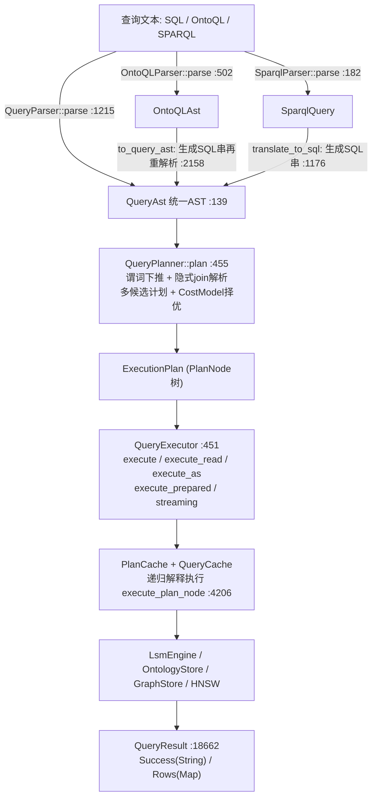

# onto-query —— 查询引擎模块

> 定位（Cargo.toml:6）："Query engine - SQL parser, semantic extensions, optimizer, and executor for OntoDB"。
> 源码规模：约 44,904 行（其中 `executor.rs` 单文件 26,116 行，实现约 19,000 行 + 测试约 7,100 行）。
> 依赖 core/storage/ontology/graph；**仅被 onto-server 依赖**。

---

## 1. 职责与边界

onto-query 负责**从查询文本到结果的完整链路**：解析、优化、执行、缓存。边界外：

- 存储引擎本身（调用 `LsmEngine`/`EngineSet` 接口）
- 本体/图算法实现（在 onto-ontology / onto-graph）
- 网络协议（由 onto-server 调用本 crate）

---

## 2. 查询处理流水线

**关键架构决策**：OntoQL 与 SPARQL 都通过"**生成 SQL 字符串 → QueryParser 重解析**"接入统一执行器（`ontoql.rs:2144-2151`、`sparql.rs:1176`），避免为每种语言维护独立执行器与 AST 类型不匹配。代价是多一次文本往返。

---

## 3. 对外核心类型

### 3.1 执行器入口（`executor.rs`）

| 名称 | 位置 | 作用 |
|------|------|------|
| `QueryExecutor` | `executor.rs:451` | 核心执行器：持有 EngineSet、OntologyStore、可选 GraphStore/TripleStore、planner、两级缓存、推理缓存、运行时统计、事务状态、命名空间 |
| `QueryActor` | `executor.rs:521` | 调用者身份 `{label,namespace,client_ip}`，用于隔离与审计 |
| `QueryResult` | `executor.rs:18662` | `Success(String)` / `Rows(Vec<Map>)` |
| `RuntimeStats` | `executor.rs:550` | 自适应优化统计（命中率、扫描次数） |

装配入口：`new(engine, ontology_store)`（`:820`）、`with_config`（`:824`），可选 `with_graph`（`:1313`）、`with_triple_store`（`:1319`）、`with_shard_router`（feature-gated，`:1326`）。

### 3.2 AST / Plan / 优化器

- `QueryAst`（`parser.rs:139-496`）：约 60+ 变体，覆盖 DDL/DML/查询/图/向量/事务/系统管理。
- `OntoQLAst`（`ontoql.rs:353-491`）、`SparqlQuery`（`sparql.rs:22`）。
- `PlanNode`（`planner.rs:16`）：SeqScan/IndexScan/IndexLookup/VectorSearch/Filter/Projection/四种 Join/Sort/Aggregation/Limit/Union/WindowFunction。
- `ExecutionPlan`（`planner.rs:167`）、`QueryPlanner`（`:419`）、`CostModel`/`CostEstimate`（`cost.rs:137,83`）。
- 缓存：`QueryCache`/`PlanCache`（`cache.rs:89,239`）、`SemanticCache`（`semantic_cache.rs:49`）。

---

## 4. 核心能力

### 4.1 OntoQL 语法

模块自述处于 "Phase 1"（`ontoql.rs:12-13`）：支持 CREATE CLASS/PROPERTY、SELECT、INSERT、UPDATE、DELETE、本体注解、`INFER` 推理、`EXPLAIN`、命名空间/事务/导入等（`ontoql.rs:508-575`）。**文档所称的 MATCH 图模式并未在 OntoQL 解析器中实现**（实际由 QueryParser 支持）。

### 4.2 谓词下推

- 逻辑层：`QueryPlanner::plan_select()` 先 `pushdown_predicates()`（`:753`）再生成候选计划并按代价择优（`:756-851`）；`split_and_predicates()` 拆 AND，`resolve_cross_joins()` 把逗号 join 转正规 JoinClause。
- 执行期二次下推：`execute_plan_node()` 的 Filter 分支合并 `Filter(SeqScan,pred)`（`:4247-4278`）；PK 点查短路（`:4244`）；n-gram/索引快速路径（`:4541-4560`）。

### 4.3 推理与类层次扩展

- **常态化推理**：`get_class_hierarchy()`（`:6462`）利用本体 `get_all_subclasses` 做向下闭包，基于 Cax-sco 规则，使 `SELECT FROM Device` 自动含子类实例；结果缓存在 `InferenceCache`（`:593-612`）。
- `INFER`：`execute_infer()`（`:7133`）→ 收集事实 → 选本体 → `Reasoner::reason()` → materialize（输出 subject/predicate/object/rule）/ augment（附加 `__types__`/`__inferred__`）双模式。
- 流式推理 `execute_infer_streaming()`（`:7259`）调用 `reasoner.reason_streaming()`；推理解释 `execute_explain_reasoning()`。

### 4.4 图遍历 / 向量检索 / SPARQL

- 图：`execute_graph_traverse_read()`（`:13199`）用 `TraversalEngine::traverse_bfs()`，实现"Lazy BFS warm-up"只加载可达边（`:13123-13154`）；`GRAPH ALGORITHM` 调用 pagerank 等（`:13096`）。
- 向量：`execute_vector_search_read()`（`:13371`）先检查索引存在非空（缺失时给出可执行错误），带 WHERE 时走 `search_filtered()`（本体类型域 + 谓词同计划下推），否则 `search_with_ef()`；结果回填文档并附加 `_distance`。
- SPARQL 1.1 子集（`sparql.rs:4-15`）：SELECT/DISTINCT、FILTER（比较/regex/bound/EXISTS）、OPTIONAL、UNION、ORDER BY/LIMIT/OFFSET、CONSTRUCT、ASK；服务端在 `http.rs:2078-2129` 完成全链路。

### 4.5 写路径与并发

- `execute()` 三级分流（`:2650-2687`）：命名空间解析 → 简单 DML 无活跃事务走**短写锁路径** `execute_dml_short_lock()`（`:2713`，begin→执行→commit/abort） → DDL/事务/复杂查询走写路径。
- `execute_read()`（`:2791`）无锁快路径：活跃事务标志为 0 时直接只读执行。
- 计划节点解释器 `execute_plan_node()`（`:4206-4488`）递归解释各 PlanNode。

---

## 5. 设计亮点

1. **三语言统一执行主干**：OntoQL/SPARQL → SQL 串 → 统一 QueryAst。
2. **双阶段优化 + 缓存**：谓词下推 + 多候选代价择优 + PlanCache/QueryCache 两级 LRU + 运行时统计自适应。
3. **大规模 OOM 防护**：`MAX_GROUPS=500_000`、Top-N 堆、流式聚合、窗口化 OFFSET/LIMIT、COUNT(*) 缓存/专用扫描、`scan_rows_sink` 流式渲染。
4. **推理与查询深度融合**：类层次闭包、INFER 双模式、细粒度推理缓存。
5. **多模态同仓**：图 BFS 懒加载、本体感知的向量过滤。
6. **安全隔离**：QueryActor 命名空间作用域 + 审计 + SPARQL 标识符净化。
7. **可诊断**：EXPLAIN / EXPLAIN REASONING / SHOW TABLE STATS / ANALYZE。

---

## 6. 实现现状与边界

| # | 现象 | 证据 |
|---|------|------|
| 1 | 联邦查询 / 语义缓存 / 融合优化器是"孤岛组件"，未接入主执行路径 | 全仓除自身文件外引用为 0 |
| 2 | 联邦查询仅元数据注册 + 计划提示，无真正执行外部查询代码 | `federated.rs:69-117` |
| 3 | OntoQL 文档称 MATCH 图模式，解析器无 MATCH 分支 | `ontoql.rs:9` vs `:508-575` |
| 4 | OntoQL TRIPLE 系列语句不经 QueryExecutor，由 server http.rs 直接处理 TripleStore | `executor.rs` 中 `OntoQLAst` 出现 0 次 |
| 5 | `QueryConfig` 注释默认值（30s/256MB）与实际（3600s/4GB）不符 | `executor.rs:387-397` |
| 6 | QueryCache / InferenceCache 失效是粗粒度全量清空 | `cache.rs:190-196`、`executor.rs:627-639` |
| 7 | PlanNode::Aggregation / Limit 在解释器中是占位（真正语义在 read 后处理） | `executor.rs:4449-4459` |
| 8 | INFER REMOTE 明确不支持；INVERSE FUNCTIONAL 不支持 | `ontoql.rs:2193-2267` |
| 9 | SPARQL CONSTRUCT/ASK 翻译有限（统一构造 SELECT） | `sparql.rs:1176-1234` |
| 10 | 每 executor 仅一个活跃事务 | `executor.rs:484-487` |
| 11 | GraphStore/TripleStore/ShardRouter 均为可选；非 SELECT 的 planner 计划为占位 | `executor.rs:455-459`、`planner.rs:490-501` |
| 12 | OntoQL 自述 Phase 1，而执行器注释到 Phase 24/25/26，演进不同步 | `ontoql.rs:12-13`、`executor.rs:4097` |
