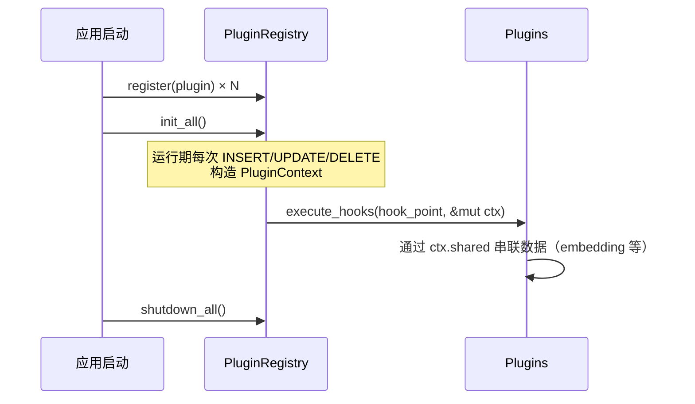

# onto-plugin —— 插件系统模块

> 定位（Cargo.toml:7）："OntoDB 插件框架 — 可扩展的 INSERT/UPDATE/DELETE 管线钩子"。
> 源码规模：约 540 行，5 个私有模块。**无单元测试，无内部 crate 依赖，也无任何下游 crate**。

---

## 1. 职责与边界

onto-plugin 定义一套**横切扩展点协议**：插件 Trait、7 类 Hook 点、执行上下文、注册表。设计目标是让 INSERT/UPDATE/DELETE 管线可插拔（例如 PreInsert 阶段自动生成 embedding）。

**关键边界**：这是一个**协议骨架**。全仓 grep 显示**没有任何 crate 依赖 onto-plugin**（仅 workspace 声明 + Cargo.lock + README 目录说明），因此其生命周期没有真实调用方。文档应表述为"已定义的扩展机制"，而非"已在运行的插件管线"。

---

## 2. 设计原则（`lib.rs:4-14`）

1. 核心不依赖具体插件。
2. 插件按 feature flag 按需编译（**但 Cargo.toml 实际无 `[features]` 段**——见实现边界）。
3. 插件通过 `PluginContext` 共享数据。
4. 钩子执行顺序由注册顺序决定。

---

## 3. 核心抽象

### 3.1 插件 Trait（`plugin.rs:39-81`）

```rust
pub trait OntoPlugin: Send + Sync {
    fn name(&self) -> &str;
    fn hooks(&self) -> Vec<HookPoint>;
    fn execute(&self, ctx: &mut PluginContext) -> PluginResult<()>;
    fn filter(&self, class: &str) -> bool { true }          // 按表过滤
    fn dependencies(&self) -> Vec<&str> { vec![] }          // 前置插件
    fn init(&mut self) -> PluginResult<()> { Ok(()) }       // 启动钩子
    fn shutdown(&mut self) -> PluginResult<()> { Ok(()) }   // 关闭钩子
    fn health(&self) -> PluginHealth { PluginHealth::Healthy }
}
```

`Send + Sync` 强制，有状态插件须内部可变性。配套 `PluginHealth::{Healthy,Degraded,Unhealthy}`（`:85-92`）。

### 3.2 Hook 点（`hook.rs:8-32`）

7 个变体：`PreInsert / PostInsert / PostCommit / PreUpdate / PostUpdate / PreDelete / PostDelete`。INSERT 主线顺序：`PreInsert → (LSM 写入) → PostInsert → (事务提交) → PostCommit`。PreInsert 可改 `ctx.doc` 生成 embedding 字段；Post* 适合副作用。

### 3.3 上下文（`context.rs:23-107`）

`PluginContext { doc, entity_key, class, shared, operation }`：

- `doc`：当前文档，PreInsert 可修改。
- `entity_key`：`{class}::{pk}` 锚点键字节。
- `shared: HashMap<String, Vec<u8>>`：插件间共享二进制数据，key 约定 `"embedding"`（bincode Vec<f32>）、`"hidden_state"`、`"value_output"`——揭示其面向"自动生成 embedding + 价值评估"的设计意图。
- `Operation::{Insert,Update,Delete}` 及三个构造器。

### 3.4 注册表（`registry.rs:37-221`）

- 三索引：`plugins: Vec<Box<dyn OntoPlugin>>`（注册顺序）、`hook_index`、`name_index`。
- `register`（`:61-97`）：名称冲突检测 + 更新索引。
- **`execute_hooks`（`:134-183`）**：按 hook 取插件 → `filter` 跳过 → 依赖存在性检查 → 执行，**任一失败立即中止**。
- `init_all`/`shutdown_all` 批量生命周期；shutdown 失败仅 warn。

### 3.5 错误类型（`error.rs:8-49`）

`PluginError` 8 变体：Config/Execution/DependencyMissing/ModelLoad/Inference/Serialization/Json/Other。其中 ModelLoad/Inference 对应 embedding 与推理插件场景。

---

## 4. 生命周期



---

## 5. 设计亮点

1. **关注点分离**：Trait 暴露 `filter`/`dependencies`/`health` 三个默认方法，注册表用三索引 O(1) 定位 hook 插件。
2. **零耦合数据传递**：`shared: HashMap<String,Vec<u8>>` + bincode 约定使插件间无需类型依赖。
3. **失败快速中止**：钩子链任一插件失败即中断，保证管线一致性。
4. **完整的生命周期与健康检查**抽象。

---

## 6. 实现现状与边界

1. **无任何 crate 依赖 onto-plugin，无调用点、无测试**——插件系统当前是协议骨架，未接入实际写入管线。
2. lib.rs 声称"插件按 feature flag 按需编译"，但 `Cargo.toml` 没有任何 `[features]` 段。
3. 注册表文档声称"`dependencies()` 自动拓扑排序确保依赖先执行"（`registry.rs:20-23`），但 `register` 仅按注册顺序 push，`execute_hooks` 只检查依赖**是否已注册**，从不排序；错误文案却写"requires ... to run first"（`error.rs:18`）。
4. 注册表文档中的示例代码是 `ignore` 文档测试，未实际验证。

> **建议**：若要在架构文档中描述插件机制，应明确标注为"设计预留、尚未启用"，避免让读者误以为写入管线已有插件在执行。
