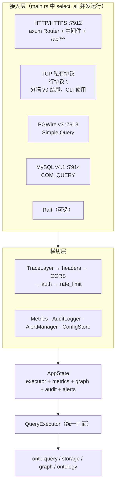

# onto-server —— 多协议服务层

> 定位：二进制 `ontodb-server`，多协议接入与服务编排层。源码规模：`http.rs` 单文件约 5,866 行，`semantic.rs` 约 2,054 行。
> 依赖 onto-core/storage/query/graph/ontology；可选私有 crate onto-raft/sharding/enterprise。不含存储/查询算法本身。

---

## 1. 职责与边界

onto-server 把下层引擎能力以 **4 种协议入口**暴露出去，并叠加认证、限流、审计、TLS、指标、告警、语义 API：

- TCP 私有协议（CLI 使用）、HTTP REST、PostgreSQL Wire v3、MySQL Wire v4.1
- 所有协议共用同一个 `QueryExecutor` 与 `QueryActor`，语义/权限/命名空间一次实现处处生效

---

## 2. 整体架构

---

## 3. 启动流程（`main.rs:376-813`）

1. `--security-audit` 早退分支（`:381-399`，分数≥80 返回 0）。
2. 企业版初始化 / 许可证校验（`:401-430`），社区版 tier 固定 `"Community"`。
3. **存储引擎打开**：`EngineSet::open_with_discovery(options)`（`:481`）自动发现命名空间子目录；同步打开磁盘索引，后台线程重建内存索引/向量/ngram（`:488-514`）；`defer_compaction_until_rebuild_done=true` 避免启动期争抢磁盘。
4. **引擎门面组装**：OntologyStore → GraphStore（`with_engine_and_limits` + `load_from_engine`）→ TripleStore → QueryExecutor（`:518-569`）。
5. 行计数恢复（row_counts.json 优先，否则 warmup，`:571-582`）。
6. REPL 或服务器分流；装配 Auth/RateLimit/Audit/Alert 配置（`:584-709`）。
7. TLS 装配（仅 cert+key 同时给出，`:644-668`）。
8. **并发服务**：`select_all` 运行 5 类服务 + 优雅退出哨兵（`:751-802`）；任一服务失败则整体退出，5 秒 drain，不在降级态运行。
9. 全局 `GuardedAllocator` 拒绝 >8GiB 单次分配并打 backtrace（`:75-125`），定位历史 compaction 损坏长度导致的崩溃。

---

## 4. HTTP API

### 4.1 路由组织（`http.rs:864-1046` build_router_with_auth）

| 类别 | 端点 |
|------|------|
| 免鉴权 | `/api/health{,/ready,/live}`、`/metrics`、`/api/docs`、`/console`、`/digital-twin` |
| 核心数据 | `/api/query`、`/sparql` + `/api/sparql`、`/api/vector/search`、`/api/hybrid/query`、`/api/batch`（企业）、`/api/schema` |
| 事务/游标/导入导出 | `/api/transaction/{begin,execute,commit,rollback}`、`/api/cursor`、`/api/export`、`/api/import` |
| 图 API | `/api/graph/{vertex,edge,traverse,shortest-path,cache/*,visualize/*,reasoning/*,pattern/match,gnn/embed,...}` |
| 语义 API | `/api/semantic/{similar,trace,infer,expand,path,gap,bridge,subgraph,explain}` |
| 运维 | `/api/backup{,/verify,/incremental}`、`/api/restore`、`/api/flush`、`/api/compact`、`/api/shutdown`、`/api/recover`、`/api/sharding/**` |
| 管理 | `/api/admin/keys...`、`/api/admin/reload`、`/api/admin/cluster/**` |

### 4.2 中间件链（`http.rs:1031-1044`）

rate_limit → auth → CORS → security_headers → ontodb_headers → TraceLayer。安全细节：`X-Frame-Options: DENY`、CSP、nosniff；CORS 显式 `allow_credentials(false)`；BodyLimit 64MB。

### 4.3 请求处理范式（以 `execute_query` 为例）

1. 抽取 `KeyInfo` → `actor_of()` 构造 `QueryActor`（`:1280-1293`）。
2. **双解析器**：先 OntoQLParser，失败回落 QueryParser（`:1307`）；三元组语句直接走 TripleStore（`:1311-1400`）。
3. **TTFT 流式快路径**（`:1769-1933`）：`std::thread::spawn` + `sync_channel` 推行批，`spawn_blocking` 桥接为异步字节流；小 LIMIT 跳过流式，ORDER BY+小 LIMIT 与 INFER materialize 强制流式。
4. 非流式走 `spawn_blocking` + `execute_read_as/execute_as`（`:1935-1953`）→ 指标 → 审计 → 慢查询日志（>1.0s）→ `StreamedRows` 零拷贝序列化。
5. 安全：`validate_filter`（黑名单 SQL 关键字/注释/分号，`:181-235`）、`validate_identifier`、`sanitize_error`（剥离文件路径）、`validate_backup_path`。

---

## 5. 多协议实现

### 5.1 PGWire v3（`pgwire.rs`）

- 协议版本 196608；连接上限 128，单消息 16MB（`:25-48`）。
- 握手（`:99-219`）：SSLRequest 直接回 N 拒绝 TLS；认证开启时发 MD5 挑战，校验 `AuthState::validate_md5`；ParameterStatus（server_version=0.6.0）。
- 查询（`:242-354`）：仅 Simple Query（Q）；RowDescription 用首行推断字段与 OID；`determine_tag` 生成 SELECT n / INSERT 0 n 等。

### 5.2 MySQL v4.1（`mysqlwire.rs`）

- 自称版本 `8.0.35-ontodb`（`:34`）；连接上限 128。
- 握手（`:131-176`）：HandshakeInitializationPacket（含伪随机 challenge）→ 解析 HandshakeResponse → `AuthState::validate` → OK 包。
- 命令循环（`:178-244`）：COM_QUERY/PING/INIT_DB（忽略）/QUIT；结果集为 列数→列定义→EOF→行→EOF。

> **可观测性边界**：两个 wire 层仅连接计数，**不调用 record_query、不写审计、不经过限流**；各自建独立 AuthState，HTTP 的 API key 热更新不作用于 wire 协议。

---

## 6. 横切关注点

| 关注点 | 模块 | 要点 |
|--------|------|------|
| 认证鉴权 | `auth.rs` | Permission{ReadOnly,ReadWrite,Admin} + API key（CIDR IP 白名单、namespace 作用域）；常量时间比较防时序攻击（`:328-336,588-598`）；支持 mtime 热重载；URL 查询参数认证显式禁用防日志泄露（`:618-623`）；XFF 取最右条目防伪造 |
| TLS | `tls.rs` | TlsConfig builder（mTLS、最低版本、证书目录自动发现）；aws-lc-rs provider；自签证书生成；HTTP→HTTPS 重定向。**仅作用于 HTTP/S** |
| 审计 | `audit.rs` | **SHA256 防篡改哈希链**（prev_hash/entry_hash，`:109-123,221-227`）；按日轮转 audit_YYYYMMDD.jsonl；默认保留 180 天满足等保 |
| 限流 | `rate_limit.rs` | 令牌桶（rpm/60，burst 容量）；key 来自 KeyInfo 或 X-Real-IP（不信任 XFF）；X-RateLimit-* 响应头；超限 429 |
| 指标 | `metrics.rs` | 无锁 AtomicCounter + Histogram（12 延迟桶 1ms~10s）；`to_prometheus()` / `to_json()`；导出前刷新 engine_stats |
| 告警 | `alerts.rs` | AlertMetric（内存/磁盘/慢查询/错误率/连接）× 状态机 Ok/Firing/Resolved × for_duration + cooldown；Log/Webhook/File 通道 |
| CDC | `cdc.rs` | 设计完整（事件模型、指数退避+DLQ+重放、InMemory/Kafka/Webhook publisher）——**但未接线**，见边界 |
| 规则服务 | `semantic.rs` | 9 个语义端点：similar/trace/infer/expand/path/gap/bridge/subgraph/explain；语义判定全部在数据层，API 只做编排（约 1000 行），换领域只换本体定义 |

---

## 7. 设计亮点

1. **四协议统一门面**：共用 QueryExecutor/QueryActor，语义/权限/隔离一处实现。
2. **共享失败即整体重启**：面向进程管理器的运维哲学。
3. **启动性能工程**：多引擎发现、磁盘索引同步开 + 内存索引后台重建、行计数持久化、延迟 compaction。
4. **TTFT 流式响应**：同步通道 + spawn_blocking 桥接异步流，边扫边发。
5. **等保 2.0 合规套件**：审计哈希链 + 180 天保留、mTLS、安全自检打分。
6. **零信任细节**：常量时间比较、URL 传 key 禁用、XFF 最右、错误脱敏、SQL 注入过滤。
7. **组合式韧性**：CDC 退避+DLQ、Raft 配置回调热更新 AuthState、API key 10 秒热重载。
8. **资源哨兵**：全局分配器拒绝异常大分配；INFER 流式 100 万条上限。

---

## 8. 实现现状与边界

1. **CDC 未接线**：CLI 参数 `cdc_enabled` 定义但从未读取，无 CdcManager 调用；README 宣称的"WAL 内核级提取"未实现。
2. PG/MySQL wire 无查询指标/审计/限流/TLS（PG 明确拒绝 SSL）；认证是相容性实现（以 API key 当"密码"），非真正用户体系。
3. 游标签名：HMAC `sign_cursor` 生成但 `verify_cursor` 只解析 offset 不校验签名，密钥硬编码（`http.rs:524-558`）。
4. 企业端点在社区版返回 403 stub（`http.rs:943-962`）；Raft/Sharding/加密/审计保留在私有 crate，开源不可见。
5. `/api/edge/report` 边缘上报接收端点**不存在**。
6. 管理 API 路由语法混用 axum 0.7 的 `:key` 与 `{key}` 两种风格（`http.rs:880` vs `admin.rs:83`）。
7. 语义 API 中 similar/expand/gap/bridge/subgraph 社区版走 stub；trace/infer/path/explain 全版本可用。
