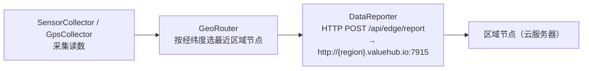
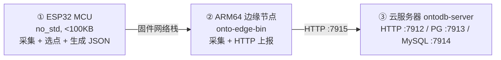

# onto-edge 系列 —— 边缘计算模块

> 涵盖三个 crate：`onto-edge`（库）、`onto-edge-bin`（可执行程序）、`onto-edge-esp32`（MCU 库，workspace 外）。
> 对应架构文档：[边缘三级部署](00-整体架构.md#7-部署架构)。

---

## 1. 三个 crate 概览

| crate | 形态 | 定位 |
|-------|------|------|
| `onto-edge` | 库 | 边缘端采集 SDK：传感器/GPS 采集、地理路由、HTTP 上报。声明依赖 onto-core/onto-storage（**源码未实际调用**） |
| `onto-edge-bin` | 二进制 `onto-edge` | CLI 参数解析 + 采集循环（**当前为模拟数据**），调用 onto-edge 库上报 |
| `onto-edge-esp32` | `no_std` 库 | MCU 级采集器（<100KB 内存）：采集 + Haversine 路由 + 生成上报 JSON 字符串。**在 workspace 之外** |

---

## 2. onto-edge 采集 SDK

### 核心类型（`lib.rs:22-63`）

- `EdgeConfig`：设备配置
- `GeoLocation` / `SensorReading` / `DeviceStatus`：地理/传感器/设备状态数据
- 模块：`collector`（`SensorCollector`、`GpsCollector`）、`reporter`（`DataReporter`）、`geo`（`GeoRouter`、`RegionNode`），`lib.rs:9-18` 统一 re-export。

### 关键流程



- `GeoRouter` 用最近节点选择（`geo.rs`），`discover_hub()` 是经纬度硬编码分区（`reporter.rs:107-136`）。
- `has_changed()` 只判断存在性（`collector.rs:50-53`）。

---

## 3. onto-edge-bin 可执行程序

- `Args`（`main.rs:15-39`）：CLI 参数解析。
- 采集循环用 `sin/cos` 生成**模拟传感器读数**（`main.rs:92-97`），非真实硬件采集。
- 交叉编译：`Dockerfile.edge-arm64` 使用 `aarch64-unknown-linux-gnu`，运行时镜像为 `scratch`。

---

## 4. onto-edge-esp32（MCU 级）

- `no_std + alloc`，内存 <100KB（`lib.rs:1-3`），手写 JSON 拼接避免 serde 序列化开销（`:130-156`），`libm` 提供三角函数。
- 核心类型：`GeoLocation`、`SensorReading`、`SensorCollector`、`GpsCollector`、`DataReporter`、`GeoRouter`（`lib.rs:15-193`）。
- Haversine 就近选点（`:160-193`）；`build_report` 只生成上报 JSON，**由宿主固件网络栈发送**。

---

## 5. 依赖关系

```
onto-edge-bin → onto-edge → (声明) onto-core / onto-storage（源码未用）
onto-edge-esp32 → serde(no_std), serde_json(alloc), heapless, libm（独立于 workspace）
```

边缘端 POST `/api/edge/report` → 区域节点（**但该服务端端点尚未实现**）。

---

## 6. 三级部署视角



统一数据模型与 API 贯穿三级（`README.md:24,340`）。

---

## 7. 设计亮点

1. **同一数据模型贯穿 MCU → 边缘 → 云**，降低异构设备接入成本。
2. **no_std 极限裁剪**：手写 JSON、libm、无堆重型依赖，适配 <100KB 内存。
3. **地理路由**：采集端按经纬度就近选择上报区域节点。

---

## 8. 实现现状与边界

1. **服务端接收端缺失**：`onto-edge` POST 的 `/api/edge/report` 端点在 `onto-server` 路由中**不存在**，完整上报链路尚未闭环。
2. onto-edge 声明依赖 onto-core/onto-storage 但源码未使用。
3. `has_changed()` 只判存在性，`discover_hub()` 经纬度硬编码。
4. onto-edge-bin 传感器读数为模拟数据。
5. ESP32：`now_ms()` 返回 0（占位）、`build_report` 只生成字符串不发送、`hub_url` 字段未参与逻辑；在 workspace 之外，不参与统一构建。
6. 区域节点地址 `valuehub.io:7915` 为示例域名，生产需配置。
