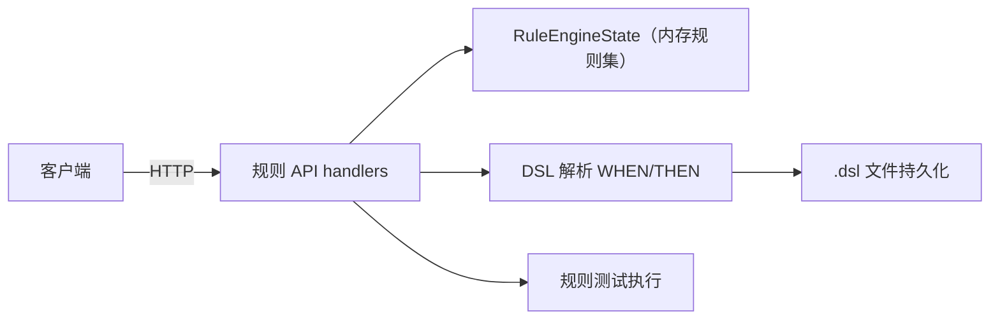

# ontodb-rules —— 规则服务模块

> 定位：独立规则 API 服务（默认端口 7912）。源码规模：`main.rs` 单文件。
> 依赖：**不依赖任何 onto-* crate**，完全独立；与 onto-server 的推理引擎无代码连接。

---

## 1. 职责与边界

ontodb-rules 提供基于 DSL 的业务规则管理能力：

- 规则的增删改查（CRUD）
- 规则热加载
- 规则测试
- 规则导入导出

规则以 `WHEN ... THEN ...` 文本 DSL 描述，持久化到 `.dsl` 文件，运行在内存中。

**边界**：它是**独立服务**，与 onto-ontology 的 OWL 推理引擎、onto-server 的语义 API 没有代码集成。README 企业版路线图中的"本体驱动规则引擎（OWL 推理结果自动触发业务规则）"（`README.md:575`）属于规划能力，当前规则服务尚未与本体推理打通。

---

## 2. 核心数据结构（`main.rs:25-96,376-393`）

| 类型 | 用途 |
|------|------|
| `RuleDto` | 规则数据传输对象 |
| `ConditionDto` / `ActionDto` | 规则条件 / 动作 |
| `RuleEngineState` | 规则引擎全局状态（内存规则集） |
| `CreateRuleRequest` / `UpdateRuleRequest` / `TestRuleRequest` / `ImportRequest` | API 请求体 |

---

## 3. 结构与流程

单文件内分区组织：

```
数据结构 (RuleDto/ConditionDto/ActionDto/...)
  → HTTP handler（CRUD / 热加载 / 测试 / 导入导出）
  → DSL 解析（WHEN/THEN 文本格式，:263-370）
  → 导入导出（:551-631）
  → main（启动服务，端口 7912）
```



---

## 4. 实现现状与边界

1. **完全独立服务**：与 onto-ontology / onto-server 推理无集成，规则仅内存 + 文件持久化（`:53-56,551-631`）。
2. 与 front-end 规则编辑器（`frontend/`）配套使用，属于外围工具链。
3. 企业版路线图所述的"本体驱动规则引擎"尚未落地。

> 定位建议：在整体架构文档中把 ontodb-rules 归为"外围工具 / 独立服务"，而非核心查询-推理主链的一环。
